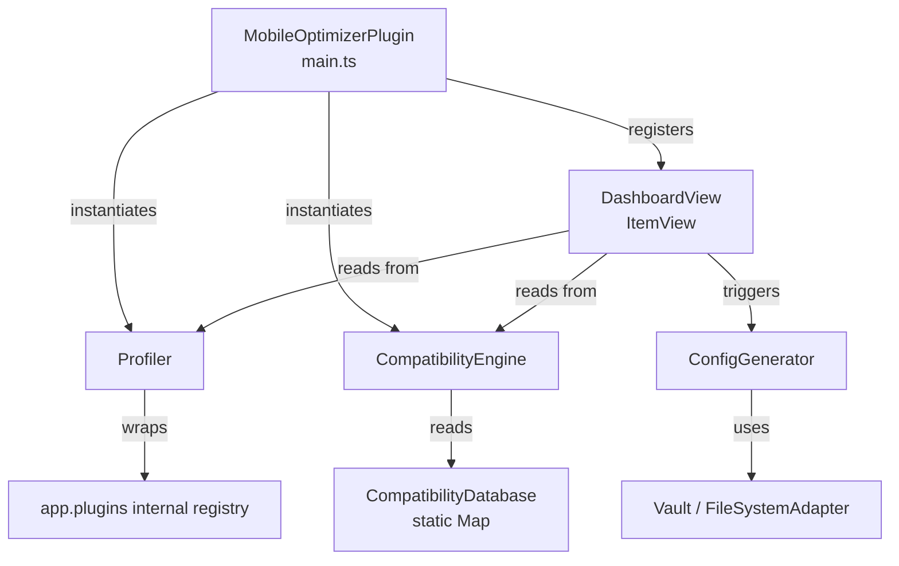

# Design Document: Obsidian Mobile Optimizer

## Overview

The Obsidian Mobile Optimizer is a community plugin for Obsidian.md that helps users identify which of their installed plugins are problematic on mobile devices. It provides a sidebar dashboard with load-time measurements and compatibility ratings per plugin, and offers a one-click tool to generate a mobile-safe `.obsidian.mobile` config folder.

The plugin is designed to be self-hosted and entirely offline — it stores its compatibility knowledge in a static in-memory map and never makes network requests. It is intentionally lightweight, built with TypeScript and native DOM APIs only (no React, no Preact), so it doesn't contribute to the problem it solves.

**Key design goals:**
- Zero external runtime dependencies beyond the Obsidian Plugin API
- Accurate load-time profiling using `performance.now()` timestamps captured at plugin initialization
- Static, hardcoded compatibility classification (no fetching)
- Full lifecycle management: register everything in `onload`, tear down everything in `onunload`
- Runs on both desktop and mobile (`isDesktopOnly: false`)

---

## Architecture

The plugin is structured as four cooperating components mounted from a single plugin entry point (`main.ts`). All coordination happens through the `MobileOptimizerPlugin` class, which owns references to all sub-components and routes user interactions.



**Data flow at startup:**
1. `MobileOptimizerPlugin.onload()` runs.
2. `Profiler` hooks into the plugin loading sequence to capture `performance.now()` timestamps.
3. `CompatibilityEngine` initializes with the static `CompatibilityDatabase`.
4. The `DashboardView` is registered as an `ItemView` with `VIEW_TYPE = "mobile-optimizer-dashboard"`.
5. A ribbon icon is added that opens the dashboard.

**Data flow when dashboard opens:**
1. `DashboardView.onOpen()` calls `Profiler.getMetrics()` for all plugins.
2. It calls `CompatibilityEngine.classify(pluginId)` for each plugin.
3. It sorts the combined results and renders the DOM table.
4. It renders the Recommendations section.
5. The "Generate Mobile Config" button is wired to `ConfigGenerator.generate()`.

---

## Components and Interfaces

### MobileOptimizerPlugin

The root plugin class extending `Plugin`. Responsible for wiring and lifecycle.

```typescript
class MobileOptimizerPlugin extends Plugin {
  profiler: Profiler;
  compatEngine: CompatibilityEngine;

  async onload(): Promise<void>;
  onunload(): void;
}
```

- Calls `this.registerView(VIEW_TYPE, (leaf) => new DashboardView(leaf, this))` in `onload`.
- Adds ribbon icon via `this.addRibbonIcon(...)`.
- Calls `this.app.workspace.detachLeavesOfType(VIEW_TYPE)` in `onunload`.

---

### Profiler

Captures load times by wrapping the plugin initialization sequence. Because Obsidian loads plugins before the optimizer itself runs, the Profiler must use a best-effort approach: it attempts to read timing data from `performance.getEntriesByType("measure")` or from the internal `app.plugins` registry if timing marks were set.

For plugins that were already loaded before the Profiler hook ran, the Load_Time is marked as unmeasurable (`null`).

```typescript
interface PluginMetric {
  pluginId: string;
  pluginName: string;
  loadTimeMs: number | null;   // null = unmeasurable
  enabled: boolean;
}

class Profiler {
  constructor(app: App);

  /** Collect metrics for all plugins currently in the registry. */
  collectMetrics(): PluginMetric[];

  /** Re-run collection (used by Refresh button). */
  refresh(): PluginMetric[];
}
```

**Plugin discovery:** The Profiler enumerates plugins via `(app as any).plugins.manifests` (the undocumented but widely-used internal registry) to access both enabled and disabled plugins. Each entry is a `PluginManifest` with `id` and `name`.

**Timing approach:** Since Obsidian does not expose per-plugin load timestamps through the public API, the Profiler uses `performance.getEntriesByName()` for any timing marks the plugin system sets, and falls back to checking `performance.getEntriesByType("resource")` for the plugin JS bundle load entries. If neither is available for a plugin, `loadTimeMs` is set to `null`.

**Enabled state:** `(app as any).plugins.enabledPlugins` is a `Set<string>` of currently enabled plugin IDs.

---

### CompatibilityEngine

Classifies each plugin ID against the static `CompatibilityDatabase`.

```typescript
type CompatibilityRating = "red" | "yellow" | "green";

class CompatibilityEngine {
  private static readonly DATABASE: ReadonlyMap<string, CompatibilityRating>;

  classify(pluginId: string): CompatibilityRating;
  getAllRed(): string[];
}
```

**Precedence rule:** If a plugin ID appears in both the Red and Green sets, `classify()` returns `"red"`. Yellow is the default for any unknown plugin ID.

---

### CompatibilityDatabase

A static `Map<string, CompatibilityRating>` initialized at module load time inside `CompatibilityEngine`. No file I/O, no network requests, no dynamic loading.

```typescript
const COMPATIBILITY_DATABASE: ReadonlyMap<string, CompatibilityRating> = new Map([
  // Red — known to be resource-heavy or incompatible with mobile
  ["dataview",                    "red"],
  ["omnisearch",                  "red"],
  ["obsidian-excalidraw-plugin",  "red"],
  ["obsidian-kanban",             "red"],
  ["obsidian-git",                "red"],
  ["surfing",                     "red"],
  ["table-editor-obsidian",       "red"],
  ["obsidian-tasks-plugin",       "red"],

  // Green — known to be lightweight and mobile-safe
  ["templater-obsidian",          "green"],
  ["calendar",                    "green"],
  ["nldates-obsidian",            "green"],
  ["quickadd",                    "green"],
]);
```

---

### DashboardView

An `ItemView` subclass that owns the complete dashboard DOM. It does not use any UI framework — all DOM manipulation is done with `document.createElement`, `el.createEl`, and similar native APIs.

```typescript
const VIEW_TYPE = "mobile-optimizer-dashboard";

class DashboardView extends ItemView {
  constructor(leaf: WorkspaceLeaf, plugin: MobileOptimizerPlugin);

  getViewType(): string;        // returns VIEW_TYPE
  getDisplayText(): string;     // returns "Mobile Optimizer"
  getIcon(): string;            // returns "smartphone"

  async onOpen(): Promise<void>;
  async onClose(): Promise<void>;

  private renderPluginList(metrics: PluginMetric[]): void;
  private renderRecommendations(redPlugins: string[]): void;
  private renderTrafficLight(container: HTMLElement, rating: CompatibilityRating): void;
}
```

**Sorting logic:** Plugins with a measured `loadTimeMs` are sorted descending by that value. Ties are broken by plugin name ascending (alphabetical). Plugins with `loadTimeMs === null` are appended at the end, sorted alphabetically among themselves.

**Traffic Light rendering:** Implemented as a `<span>` with a CSS class (`traffic-red`, `traffic-yellow`, `traffic-green`) and an accessible `aria-label`. Colors applied via inline styles or a minimal injected stylesheet.

---

### ConfigGenerator

Handles the `.obsidian → .obsidian.mobile` copy operation.

```typescript
class ConfigGenerator {
  constructor(app: App, compatEngine: CompatibilityEngine);

  /** Entry point — called when "Generate Mobile Config" is clicked. */
  async generate(onProgress: (state: "start" | "done" | "error") => void): Promise<void>;

  private copyRecursive(srcPath: string, destPath: string): Promise<void>;
  private patchCommunityPlugins(destPath: string): Promise<void>;
  private confirmOverwrite(): Promise<boolean>;
}
```

**File operations:** Uses `app.vault.adapter` (a `FileSystemAdapter` on desktop) for all I/O:
- `adapter.exists(path)` — check existence
- `adapter.list(path)` — list directory contents (returns `{ files, folders }`)
- `adapter.read(path)` — read file content
- `adapter.write(path, content)` — write file content
- `adapter.mkdir(path)` — create directory
- `adapter.copy(src, dest)` — copy individual file (falls back to read+write if unavailable)

**Recursive copy algorithm:**
1. Call `adapter.mkdir(destPath)`.
2. Call `adapter.list(srcPath)` to get files and sub-folders.
3. For each file: copy with `adapter.copy` or read+write.
4. For each sub-folder: recurse.

**Error handling during copy:** On any I/O error, stop and surface the failing path in the error notification. Partial output is left in place.

**community-plugins.json patching:**
1. After the full copy, read `.obsidian.mobile/community-plugins.json`.
2. Parse the JSON array of plugin IDs.
3. Filter out any IDs that `CompatibilityEngine.classify()` returns `"red"` for.
4. Write the filtered array back.
5. If the file doesn't exist in the source, create it with `[]`.

---

## Data Models

### PluginMetric

Represents everything the dashboard knows about a single plugin.

```typescript
interface PluginMetric {
  pluginId: string;
  pluginName: string;
  loadTimeMs: number | null;         // null when unmeasurable
  rating: CompatibilityRating;       // "red" | "yellow" | "green"
  enabled: boolean;                  // whether currently enabled in Obsidian
}
```

### CompatibilityRating

```typescript
type CompatibilityRating = "red" | "yellow" | "green";
```

### DashboardState

Ephemeral in-memory state held by `DashboardView` between renders.

```typescript
interface DashboardState {
  metrics: PluginMetric[];
  isGenerating: boolean;
  lastRefreshedAt: Date | null;
}
```

### GeneratorResult

```typescript
type GeneratorResult =
  | { ok: true }
  | { ok: false; errorPath: string; message: string };
```

---

## Correctness Properties

*A property is a characteristic or behavior that should hold true across all valid executions of a system — essentially, a formal statement about what the system should do. Properties serve as the bridge between human-readable specifications and machine-verifiable correctness guarantees.*

### Property 1: Classification completeness

*For any* plugin ID string, `CompatibilityEngine.classify()` SHALL return exactly one of `"red"`, `"yellow"`, or `"green"` — never `undefined`, `null`, or any other value.

**Validates: Requirements 3.1, 3.4**

---

### Property 2: Red takes precedence over Green

*For any* plugin ID that is present in both the Red set and the Green set of the `CompatibilityDatabase`, `CompatibilityEngine.classify()` SHALL return `"red"`.

**Validates: Requirements 3.3**

---

### Property 3: Unknown plugins default to Yellow

*For any* plugin ID that is absent from the `CompatibilityDatabase`, `CompatibilityEngine.classify()` SHALL return `"yellow"`.

**Validates: Requirements 3.4, 1.4**

---

### Property 4: Plugin list sort order invariant

*For any* collection of `PluginMetric` objects, after the dashboard sort is applied:
- All plugins with `loadTimeMs !== null` appear before all plugins with `loadTimeMs === null`.
- Among measured plugins, `loadTimeMs` values are in non-increasing (descending) order.
- Among measured plugins with equal `loadTimeMs`, names are in non-decreasing (ascending) alphabetical order.
- Among unmeasured plugins, names are in non-decreasing alphabetical order.

**Validates: Requirements 2.4, 2.5**

---

### Property 5: community-plugins.json round-trip removes only Red plugins

*For any* array of plugin IDs written to `community-plugins.json`, after `ConfigGenerator.patchCommunityPlugins()` runs, the resulting array SHALL contain exactly the plugin IDs from the original array that are NOT classified as `"red"`, in the same relative order.

**Validates: Requirements 4.3**

---

### Property 6: Load time display format

*For any* `PluginMetric` where `loadTimeMs` is a non-null number, the rendered Load_Time string SHALL be the value rounded to two decimal places followed by " ms", and SHALL NOT be "—".

*For any* `PluginMetric` where `loadTimeMs` is `null`, the rendered Load_Time string SHALL be "—" and SHALL NOT contain a number.

**Validates: Requirements 2.2, 1.6, 2.4**

---

### Property 7: Recommendations section correctness

*For any* collection of `PluginMetric` objects rendered into the dashboard:
- The Recommendations section SHALL contain an entry for every plugin whose `rating` is `"red"`.
- The Recommendations section SHALL contain NO entries for plugins whose `rating` is `"yellow"` or `"green"`.
- If no plugins have `rating === "red"`, the section SHALL display the "no high-risk plugins detected" message and list no plugin names.

**Validates: Requirements 3.6, 3.7**

---

## Error Handling

### Profiler errors

- If `app.plugins` or `app.plugins.manifests` is inaccessible (e.g., older Obsidian version), the Profiler catches the error and returns an empty metrics array. The dashboard renders with a notice that plugin data could not be loaded.
- If timing data is unavailable for a specific plugin, `loadTimeMs` is set to `null`; the dashboard renders "—" for that row.

### ConfigGenerator errors

| Condition | Behavior |
|---|---|
| `.obsidian` folder not found | Error notification: "Config folder `.obsidian` not found. Cannot generate mobile config." No write attempt. |
| `.obsidian.mobile` exists (pre-check) | Modal confirmation prompt. If user cancels → silent abort. If user confirms → proceed with overwrite. |
| I/O error during recursive copy | Error notification including the failing file/folder path. Partial output left in place. Button re-enabled. |
| `community-plugins.json` missing in source | Create `.obsidian.mobile/community-plugins.json` with content `[]`. Not treated as an error. |
| `community-plugins.json` contains invalid JSON | Error notification stating the file could not be parsed. Operation stops; partial copy left in place. |

### UI error states

- The "Generate Mobile Config" button is disabled with a loading spinner during the operation (set `button.disabled = true`, inject a spinner element).
- On completion (success or error), the button is re-enabled (`button.disabled = false`), the spinner is removed, and the appropriate notification is shown via `new Notice(...)`.

---

## Testing Strategy

### Dual Testing Approach

Both unit tests and property-based tests are used:
- **Unit tests** verify concrete behaviors, integration points, and error conditions with specific examples.
- **Property-based tests** verify universal invariants across a large random input space.

The property-based testing library for this project is **[fast-check](https://github.com/dubzzz/fast-check)** (TypeScript-native, no additional transpilation needed). Each property test is configured to run a minimum of 100 iterations.

Each property test is tagged with a comment referencing the design property:
```
// Feature: obsidian-mobile-optimizer, Property N: <property text>
```

### Unit Tests

**CompatibilityEngine**
- Each ID in the Red list classifies as `"red"`.
- Each ID in the Green list classifies as `"green"`.
- An arbitrary unknown ID classifies as `"yellow"`.
- `getAllRed()` returns exactly the IDs from the Red list.

**Profiler**
- Returns a `PluginMetric` for every plugin ID in the manifest registry.
- Sets `loadTimeMs: null` for plugins that have no timing data.
- The `enabled` flag matches the plugin's actual enabled state.

**DashboardView sorting**
- Measured plugins sort before unmeasured ones.
- Within measured plugins, descending by `loadTimeMs`; ties broken alphabetically.
- Unmeasured plugins sort alphabetically among themselves.

**ConfigGenerator**
- Abort (no write) when source `.obsidian` is missing.
- Abort (no write) when user cancels the overwrite confirmation.
- `patchCommunityPlugins` removes Red plugin IDs and preserves Green/Yellow IDs.
- `patchCommunityPlugins` creates `[]` when the source file is absent.
- Error notification includes the file path on I/O failure.

### Property-Based Tests

Each test uses `fast-check` generators and runs at least 100 iterations.

**Property 1 — Classification completeness**
```
// Feature: obsidian-mobile-optimizer, Property 1: classify returns red/yellow/green for any input
fc.assert(fc.property(fc.string(), (id) => {
  const result = engine.classify(id);
  return result === "red" || result === "yellow" || result === "green";
}));
```

**Property 2 — Red takes precedence**
```
// Feature: obsidian-mobile-optimizer, Property 2: red overrides green for same ID
```
Generate arbitrary plugin IDs, insert them into both sets, confirm `classify` returns `"red"`.

**Property 3 — Unknown plugins default to Yellow**
```
// Feature: obsidian-mobile-optimizer, Property 3: absent IDs classify as yellow
```
Generate strings guaranteed not to be in the database; confirm `"yellow"` is returned.

**Property 4 — Sort order invariant**
```
// Feature: obsidian-mobile-optimizer, Property 4: sort produces valid ordering for any plugin list
```
Generate arbitrary arrays of `PluginMetric`, apply the sort, verify all ordering conditions hold.

**Property 5 — community-plugins.json round-trip**
```
// Feature: obsidian-mobile-optimizer, Property 5: patching removes only red plugins
```
Generate random arrays of plugin IDs (mix of Red, Green, Yellow, and unknown). Run `patchCommunityPlugins`. Verify output contains exactly the non-Red IDs, in the original relative order.

**Property 6 — Load time display format**
```
// Feature: obsidian-mobile-optimizer, Property 6: load time renders correctly for any numeric or null value
```
Generate arbitrary `number | null` values. For numbers, verify the rendered string matches the two-decimal-places format. For `null`, verify it renders `"—"`.

**Property 7 — Recommendations section correctness**
```
// Feature: obsidian-mobile-optimizer, Property 7: recommendations match exactly the red-rated plugins
```
Generate arbitrary arrays of `PluginMetric` with random ratings. Render recommendations. Verify the listed plugins are exactly the ones with `rating === "red"`.
